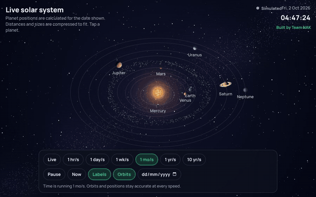
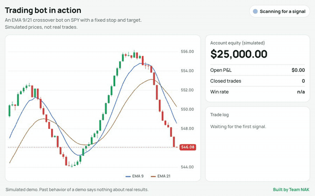
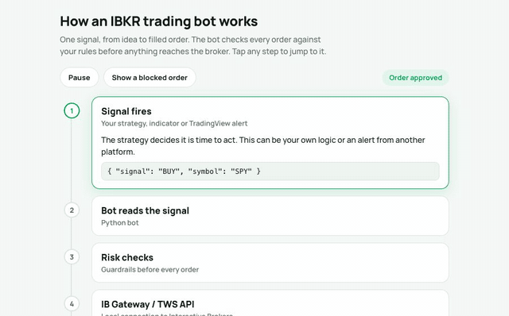
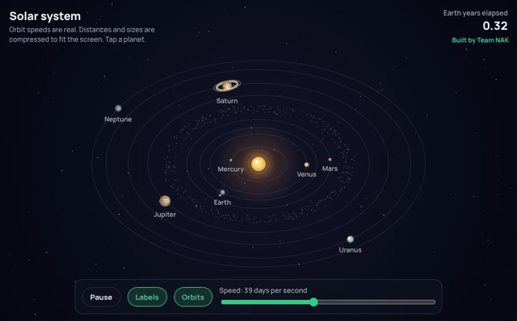

# Team NAK Demos

Interactive demos built with Claude Sonnet 5.5. Each one is a single self-contained HTML page, with no build step and no dependencies.

**[▶ Open the live demos](https://nadiraliofficial.github.io/team-nak-demos/)**

## Demos

### Live solar system
Real orbital elements and the real date. Speed the clock from live time up to a year per second.

### Trading bot in action
A simulated EMA 9/21 crossover bot on a live-moving chart, with a trade log and simulated account equity.

### How an IBKR bot works
An animated walkthrough from signal to filled order, including risk checks and a blocked-order case.

### Sunset ride
An animated cyclist scene.

### Solar system v1
The first, simpler version of the solar system.

## Run locally

Open `index.html` in a browser.

## Notes

Trading data in the demos is simulated and is not financial advice. Nothing here is a real trade or result.

Built by [Team NAK](https://www.theteamnak.com/).
